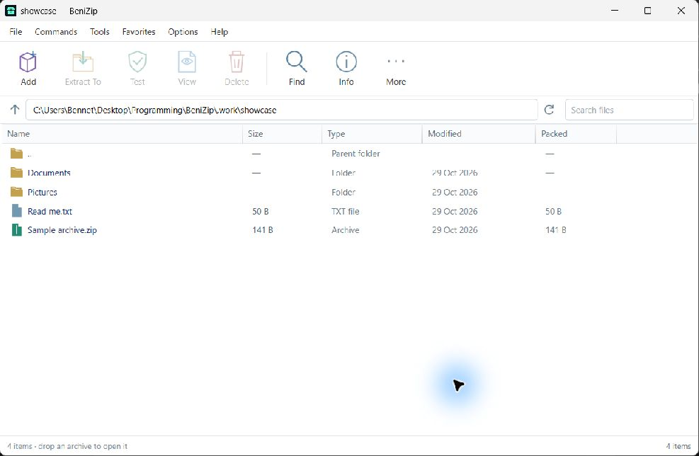

# BeniZip

A compact, native Windows archive manager. Clean white windows, familiar archive commands, and no account or subscription.

[Download the Windows installer](https://github.com/Benighter/BeniZip/releases/latest) · [Release notes](CHANGELOG.md) · [MIT licence](LICENSE)



## What it does

- Browse archives and ordinary folders, search, sort and inspect file properties.
- Extract everything or selected members, with progress, current file, cancellation, elapsed time, estimated speed and remaining time.
- Preview text, images and nested archives without changing the original archive.
- Create and edit ZIP and 7z archives, and create RAR5 archives and edit supported RAR archives, without WinRAR. Passwords and split volumes are available for creation.
- Test archive integrity and handle existing files with rename, skip or overwrite.
- Reject unsafe archive paths, Windows device names, alternate data streams, symbolic links and redirected extraction destinations.
- Integrate with Explorer: Open, Extract, Extract here and Compress.
- Check for updates automatically, verify the publisher's RSA signature and package checksum, then ask before installing and restarting.

The window opens at 1000 × 650 and remembers your preferred size.

## Install and file defaults

Windows 10/11, x64, with .NET Framework 4.8. Run `BeniZip-Setup-0.2.3.exe` from the latest release. It installs for your account without administrator access.

**Every supported archive type is selected by default:** ZIP, RAR, 7z, TAR, GZ, TGZ, BZ2, XZ, ZST, CAB, ARJ, LZH and 001. Setup registers those types, Explorer commands and shortcuts. You can change the selection in Options → Default archive app. The screen shows which types actually open in BeniZip.

Windows protects existing default-app choices. Setup opens Windows' confirmation screen when confirmation is required; it cannot silently replace those choices. Select BeniZip there for the remaining types. This uses Windows' supported [default-app registration](https://learn.microsoft.com/en-us/windows/win32/shell/default-programs).

The application lives in `%LOCALAPPDATA%\Programs\BeniZip`. Preferences and the uninstaller live separately in `%LOCALAPPDATA%\BeniZip`. Uninstall from Windows Settings → Apps; your archives and preferences are preserved.

## Updates

The public channel is `https://github.com/Benighter/BeniZip/releases/latest/download/manifest.json`. BeniZip checks on startup and periodically, at most once every six hours, and offers available updates. Use Options → Check for updates for an immediate check.

The signed manifest pins the application ID, version, download URL, byte count and SHA-256. An independent updater rechecks the signature and package before replacing the installed application. No private signing key ships in the source or application. Release verification is separate from Windows Authenticode; the installer is not Authenticode signed.

## Build and test

No private key or paid SDK is needed to build. From a Windows PowerShell prompt:

```powershell
./scripts/Build.ps1
python tests/verify.py --cancel-check --skip-rar
python tests/verify_editing.py --skip-rar
python tests/verify_rar.py
```

The build uses the .NET Framework compiler included with Windows. Python 3.11+ is used for tests. The icon is checked in; Python/Pillow is only needed to regenerate it. The first two suites skip their legacy WinRAR-specific fixtures; `verify_rar.py` exercises the built-in RAR engine and checks its output with 7-Zip. GitHub Actions runs all three suites without WinRAR.

Output is `build/app-0.2.3.0`. `scripts/Install.ps1` installs a source build for development; an existing different release must use the signed updater or setup.

Maintainers publish using `scripts/Build-Release.ps1`, with the existing private key stored outside the repository. It creates a signed runtime ZIP, manifest, installer and checksums. Publish those as assets of the matching `v0.2.3` GitHub release. Keep published versions immutable. The default feed and pinned public key are explicit in source so forks can establish their own release identity.

## Scope and licences

BeniZip's interface and application code are original, MIT-licensed work by Bennet Nkolele. The separately licensed 7-Zip 26.04 and rars 0.12.3 engines are included; see [third-party notices](THIRD-PARTY-NOTICES.md) and their included licences. Matching 7-Zip source is linked there and included with the GitHub release.

RAR creation produces RAR5. Editing does not support every RAR feature: split archives and protected archives with unsupported metadata are left unchanged. When an unprotected archive needs rebuilding, BeniZip asks first and saves an original backup; some metadata or recovery records may be lost from the rebuilt archive. Editing protected RARs temporarily stages decrypted contents on disk and normally removes the temporary data afterward; a crash may leave it behind. Archive repair and SFX authoring are not implemented. Multi-layer formats such as TAR.GZ can be opened layer by layer. Existing-folder extraction checks conflicts first; a late disk error can still leave some already merged files. New-folder extraction is staged and published only after successful integrity checks.

